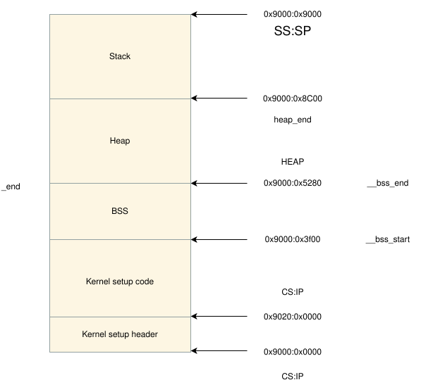

# Kernel booting process - Part 2

We have already started our journey into the Linux kernel in the previous [part](./linux-bootstrap-1.md), where we walked through the very early stages of the booting process and the first assembly instructions of the Linux kernel code. Among other things, this assembly code was responsible for preparing the environment for [C](https://en.wikipedia.org/wiki/C_(programming_language)) code. From here on, we will still see some assembly code on our way, but it will be more and more rare. Now it is time for more "high-level" logic!

Our last stop was a symbolic milestone - the very first call of a C function. It has the classic name [`main`](https://en.wikipedia.org/wiki/Entry_point) and is defined in the [arch/x86/boot/main.c](https://github.com/torvalds/linux/blob/master/arch/x86/boot/main.c) source code file. But what is this function intended to do?

The `main` function is a part of the kernel setup code, which, as we know, is still running in [real mode](https://en.wikipedia.org/wiki/Real_mode). One of its primary tasks is to move the processor into [protected mode](https://en.wikipedia.org/wiki/Protected_mode). From there, the next stage of the kernel switches it into [long mode](https://en.wikipedia.org/wiki/Long_mode), the native 64-bit mode of x86_64 processors. Almost all of the C code we will see in the next parts serves two goals - to collect information about the machine for the kernel, and to prepare these transitions.

In this part, we will keep digging through the kernel's setup code that covers some of these preparations:

- Preparation of I/O port operations and copying of the kernel setup header
- Setup of early console and heap
- Validation of the CPU
- Detection of available memory
- Initialization of the keyboard
- Gathering of additional information about the system

Time to explore these steps in detail! Let's continue from the point where we stopped in the previous part.

## The main function

Like most programmers, you have probably met a function with the name `main`. Usually, it is the place where a program starts. But before this function gets control, a lot of work has to be done for it:

- The operating system loads the program into memory
- The dynamic linker loads the shared libraries that the program needs
- The startup code of the C runtime sets up thread-local storage and runs the constructors
- Finally, it takes the command-line arguments that the operating system left on the stack and passes them to `main`

And only after these and other actions are performed, the `main` function is called.

The `main` function that we are going to look at has the same name, but almost none of this is done for it. First of all, obviously there is no operating system underneath, because this code only prepares to start one. All the preparation that this `main` got is the few assembly instructions we saw in the previous part - the segment registers, the stack, and the cleared `.bss` section. There is no standard library or C runtime either. If the kernel setup code needs to copy memory or to print a message, there is no choice - it has to bring its own functions for this.

This `main` does not even take arguments, as there is nobody to pass them. Everything it needs to know, it has to find out by itself or to take from the kernel setup header that was filled by the bootloader. Its body is just a sequence of function calls, each responsible for one preparation step, and we will go through them one by one in the next sections.

### I/O port operations

If we look at the very beginning of the `main` function from the [arch/x86/boot/main.c](https://github.com/torvalds/linux/blob/master/arch/x86/boot/main.c), the very first thing we will see is a call of the `init_default_io_ops` function. This function is defined in the [arch/x86/boot/io.h](https://github.com/torvalds/linux/blob/master/arch/x86/boot/io.h) and looks like:

<!-- https://raw.githubusercontent.com/torvalds/linux/refs/heads/master/arch/x86/boot/io.h#L26-L31 -->
```C
static inline void init_default_io_ops(void)
{
	pio_ops.f_inb  = __inb;
	pio_ops.f_outb = __outb;
	pio_ops.f_outw = __outw;
}
```

This function initializes three function pointers used to access [I/O](https://en.wikipedia.org/wiki/Memory-mapped_I/O_and_port-mapped_I/O) ports:

- `f_inb` reads a byte from a port
- `f_outb` writes a byte to a port
- `f_outw` writes a word (16 bits) to a port

You may ask why the kernel needs function pointers here instead of calling these functions directly. The reason is that the same code is used at the next stages of the boot process as well, where the kernel may run as a guest protected by [Intel TDX](https://docs.kernel.org/arch/x86/tdx.html). Such a guest cannot simply execute I/O instructions. It has to ask the hypervisor to do the operation, so in this case the pointers are replaced with functions that do exactly this. By default, the pointers lead to the functions that execute the regular I/O instructions.

These callbacks will be used to communicate with the serial console which will be initialized at one of the [next steps](#console-initialization). All the operations will be executed with the help of the `inb`, `outb`, and `outw` macros which are defined in the same file:

<!-- https://raw.githubusercontent.com/torvalds/linux/refs/heads/master/arch/x86/boot/io.h#L37-L39 -->
```C
#define inb  pio_ops.f_inb
#define outb pio_ops.f_outb
#define outw pio_ops.f_outw
```

The `__inb`, `__outb`, and `__outw` themselves are inline functions from the [arch/x86/include/asm/shared/io.h](https://github.com/torvalds/linux/blob/master/arch/x86/include/asm/shared/io.h):

<!-- https://raw.githubusercontent.com/torvalds/linux/refs/heads/master/arch/x86/include/asm/shared/io.h#L7-L24 -->
```C
#define BUILDIO(bwl, bw, type)						\
static __always_inline void __out##bwl(type value, u16 port)		\
{									\
	asm volatile("out" #bwl " %" #bw "0, %w1"			\
		     : : "a"(value), "Nd"(port));			\
}									\
									\
static __always_inline type __in##bwl(u16 port)				\
{									\
	type value;							\
	asm volatile("in" #bwl " %w1, %" #bw "0"			\
		     : "=a"(value) : "Nd"(port));			\
	return value;							\
}

BUILDIO(b, b, u8)
BUILDIO(w, w, u16)
BUILDIO(l,  , u32)
```

All of these functions use `in` and `out` assembly instructions which send the given value to the given port or read the value from the given port. If the syntax is not familiar to you, you can read the part about [inline assembly](../Toolchain/linux-toolchain-4.md).

### Copying the setup header

After the I/O callbacks are initialized, the next step is copying of the kernel setup header filled by a bootloader into the corresponding field of the C `boot_params` structure. This will make the fields from the kernel setup header more easily accessible. All the copying is handled by the `copy_boot_params` function with the help of `memcpy`:

<!-- https://raw.githubusercontent.com/torvalds/linux/refs/heads/master/arch/x86/boot/main.c#L39-L39 -->
```C
	memcpy(&boot_params.hdr, &hdr, sizeof(hdr));
```

Do not mix up this `memcpy` with the function from the C standard library - [memcpy](https://man.archlinux.org/man/memcpy.3). As we already know, there is no standard library at this stage. If we look at the [arch/x86/boot/string.h](https://github.com/torvalds/linux/blob/master/arch/x86/boot/string.h), we will see that `memcpy` is a macro there:

<!-- https://raw.githubusercontent.com/torvalds/linux/refs/heads/master/arch/x86/boot/string.h#L17-L17 -->
```C
#define memcpy(d,s,l) __builtin_memcpy(d,s,l)
```

The [`__builtin_memcpy`](https://gcc.gnu.org/onlinedocs/gcc/Library-Builtins.html) is a builtin function of the compiler. The compiler knows what this function does and is free to choose how to implement it. If the size is small and known at compile time, it can generate the copying instructions right in place of the call. In other cases, it generates a regular call of a function with the name `memcpy`. As there is no library to provide it, the kernel setup code has to bring its own implementation. It is defined in the [copy.S](https://github.com/torvalds/linux/blob/master/arch/x86/boot/copy.S). If you have already started to miss assembly code, it is high time to bring some back:

<!-- https://raw.githubusercontent.com/torvalds/linux/refs/heads/master/arch/x86/boot/copy.S#L18-L32 -->
```assembly
SYM_FUNC_START_NOALIGN(memcpy)
	pushw	%si
	pushw	%di
	movw	%ax, %di
	movw	%dx, %si
	pushw	%cx
	shrw	$2, %cx
	rep movsl
	popw	%cx
	andw	$3, %cx
	rep movsb
	popw	%di
	popw	%si
	retl
SYM_FUNC_END(memcpy)
```

First of all, we can see that `memcpy` and other routines which are defined there start and end with the two macros - `SYM_FUNC_START_NOALIGN` and `SYM_FUNC_END`. The `SYM_FUNC_START_NOALIGN` just specifies the given symbol name as [.globl](https://sourceware.org/binutils/docs/as.html#Global) to make it visible for other functions. The `SYM_FUNC_END` macro expands to something like this:

```
.type memcpy, STT_FUNC
.set .L__sym_size_memcpy, .-memcpy
.size memcpy, .L__sym_size_memcpy
```

The first line marks the `memcpy` symbol as a function in the [ELF](https://en.wikipedia.org/wiki/Executable_and_Linkable_Format) symbol table. The last two lines calculate the function's size in bytes and record it in the ELF symbol table as well.

Although this function is written in assembly language, the implementation of `memcpy` is relatively simple to understand. At first, it pushes values from the `si` and `di` registers to the stack to preserve them because they will change during the `memcpy` execution. At the next step we may see handling of the function's parameters. The parameters of this function are passed through the `ax`, `dx`, and `cx` registers. This is because the kernel setup code is built with the `-mregparm=3` option. So, if the compiler generated a call for the copy of the setup header:

- `ax` will contain the address of `boot_params.hdr` - the field of the `boot_params` structure where the header is copied to
- `dx` will contain the address of `hdr` - the kernel setup header filled by the bootloader
- `cx` will contain the size of `hdr` in bytes

The `rep movsl` instruction copies bytes from the memory pointed to by the `si` register to the memory location pointed to by the `di` register. At each iteration 4 bytes are copied. For this reason the size is divided by 4 using the [`shrw`](https://www.felixcloutier.com/x86/sal:sar:shl:shr) instruction. After this step we just copy the remaining bytes when the size is not divisible by 4.

From this point, the setup header is copied into a proper place and we can move forward.

### Console initialization

As soon as the kernel setup header is copied into the `boot_params.hdr`, the next step is to initialize the [serial console](https://docs.kernel.org/admin-guide/serial-console.html) by calling the `console_init` function. Very soon we will be able to print something from within the kernel code!

The `console_init` function is defined in [arch/x86/boot/early_serial_console.c](https://github.com/torvalds/linux/blob/master/arch/x86/boot/early_serial_console.c). It tries to find the `earlyprintk` or `console` option in the kernel's [command line](https://docs.kernel.org/admin-guide/kernel-parameters.html). If the option is found, it parses the given port address and [baud rate](https://en.wikipedia.org/wiki/Baud) and initializes this port.

Let's take a look at these two options in detail.

The `earlyprintk` option specifies where the early messages should be sent, for example to the [VGA](https://en.wikipedia.org/wiki/VGA_text_mode) screen or to a serial port. Strictly speaking, the kernel setup code does not need this option to print on the screen. When it has something to report, it prints the message on the screen using BIOS routines. The `earlyprintk` option only adds a serial port as one more place where such messages go. So the kernel setup code is interested only in the serial port case, where the values look like:

- `serial,0x3f8,115200`
- `serial,ttyS0,115200`
- `ttyS0,115200`

The word `serial` at the beginning says that the messages should go to a serial port. It can be omitted if the value starts with the name of a serial device, like in the last example. The next part is the port itself. It can be specified in two ways:

- by its address in the I/O address space
- by the name of the device

Only two names are supported: `ttyS0` and `ttyS1`. They correspond to the ports `0x3f8` and `0x2f8` respectively, which you may know as `COM1` and `COM2`.

The last number is the baud rate, the speed of the transmission in bits per second.

If the `earlyprintk` option is missing or its value does not contain a serial port, the `console_init` function looks for the `console` kernel command line option with a value like `uart8250,io,0x3f8,115200`. The `uart8250` is the name of the [chip](https://en.wikipedia.org/wiki/8250_UART) behind the serial ports of a PC, and after the `io` keyword go the address of the port and the baud rate.

The kernel setup code searches for both options in the kernel command line. The pointer to it is stored in the kernel setup header that was copied in the [previous section](#copying-the-setup-header) and is accessed using the `boot_params.hdr.cmd_line_ptr` field. There is nothing specific to the Linux kernel in the initialization of a serial port itself, so we will skip this part. If you want to dive deeper, you can find more information [here](https://wiki.osdev.org/Serial_Ports#Port_Addresses) and go through [arch/x86/boot/early_serial_console.c](https://github.com/torvalds/linux/blob/master/arch/x86/boot/early_serial_console.c) step by step.

After the serial port is initialized, we can see the first output if the `debug` option was passed in the kernel command line:

<!-- https://raw.githubusercontent.com/torvalds/linux/refs/heads/master/arch/x86/boot/main.c#L142-L143 -->
```C
	if (cmdline_find_option_bool("debug"))
		puts("early console in setup code\n");
```

The `puts` function prints each character on the screen with the help of the BIOS. If a serial port was initialized, it also sends the character there, using the `inb` and `outb` macros that we have seen above.

From this point we can print messages from the kernel setup code 🎉.

Time to move to the next step.

### Heap initialization

We have seen the initialization of the `stack` and `bss` memory areas in the previous part. The next step is to initialize the [heap](https://en.wikipedia.org/wiki/Memory_management#HEAP) memory area. The heap initialization takes place in the `init_heap` function:

<!-- https://raw.githubusercontent.com/torvalds/linux/refs/heads/master/arch/x86/boot/main.c#L118-L131 -->
```C
static void init_heap(void)
{
	char *stack_end;

	if (boot_params.hdr.loadflags & CAN_USE_HEAP) {
		stack_end = (char *) (current_stack_pointer - STACK_SIZE);
		heap_end = (char *) ((size_t)boot_params.hdr.heap_end_ptr + 0x200);
		if (heap_end > stack_end)
			heap_end = stack_end;
	} else {
		/* Boot protocol 2.00 only, no heap available */
		puts("WARNING: Ancient bootloader, some functionality may be limited!\n");
	}
}
```

First of all, `init_heap` checks the `CAN_USE_HEAP` flag from the kernel setup header. We can find information about this flag in the kernel boot protocol:

>   Bit 7 (write): CAN_USE_HEAP
>
>	Set this bit to 1 to indicate that the value entered in the
>	heap_end_ptr is valid.  If this field is clear, some setup code
>	functionality will be disabled.
>
> -- *The Linux/x86 Boot Protocol*, "Details of Header Fields", `loadflags`

If this bit is not set, we will see the warning message. Otherwise, the heap memory area is initialized. The beginning of the heap is defined by the `HEAP` pointer, which points to the end of the kernel setup image:

<!-- https://raw.githubusercontent.com/torvalds/linux/refs/heads/master/arch/x86/boot/main.c#L22-L22 -->
```C
char *HEAP = _end;
```

Now we need to initialize the size of the heap. To understand how it is done, we can use another small hint from the Linux kernel boot protocol:

> ### `heap_end_ptr`
>
> | Property          | Value               |
> | ----------------- | ------------------- |
> | **Type**          | Write (obligatory)  |
> | **Offset / size** | `0x224` / `2` bytes |
> | **Protocol**      | `2.01+`             |
>
> Set this field to the offset, from the beginning of the real-mode code, of the end of the setup stack/heap, minus `0x0200`.
>
> -- *The Linux/x86 Boot Protocol*, "Details of Header Fields", `heap_end_ptr`

The GRUB bootloader sets this value to:

```C
#define GRUB_LINUX_HEAP_END_OFFSET	(0x9000 - 0x200)
```

This initially gives `heap_end` a value of `0x9000`. At this point, the kernel setup code calculates the address where the stack ends. The size of the initial stack is defined by the `STACK_SIZE` macro, which is 1024 bytes. Since GRUB sets the stack pointer to `0x9000`, the calculated stack end is below `0x9000`. To avoid a clash between the heap and stack areas, the kernel setup code compares their end addresses. If the heap end is above the stack end, it moves the heap end right below the stack. As a result, the heap area is located above the `bss` area and extends up to the stack. The resulting memory map looks like this:



Now the heap is initialized, but we will see how it is used only in the next parts.

### CPU validation

The next step is the validation of the CPU on which the kernel is running. The kernel has to do it to make sure that all required features will work correctly on the given CPU.

The `validate_cpu` function from [arch/x86/boot/cpu.c](https://github.com/torvalds/linux/blob/master/arch/x86/boot/cpu.c) validates the CPU. This function calls the [`check_cpu`](https://github.com/torvalds/linux/blob/master/arch/x86/boot/cpucheck.c) which checks the CPU model and its flags using the [cpuid](https://en.wikipedia.org/wiki/CPUID) instruction. It checks CPU flags like the presence of [long mode](https://en.wikipedia.org/wiki/Long_mode), checks the processor's vendor and makes preparations for certain vendors such as turning on extensions like [SSE+SSE2](https://en.wikipedia.org/wiki/Single_instruction,_multiple_data):

<!-- https://raw.githubusercontent.com/torvalds/linux/refs/heads/master/arch/x86/boot/cpu.c#L60-L86 -->
```C
int validate_cpu(void)
{
	u32 *err_flags;
	int cpu_level, req_level;

	check_cpu(&cpu_level, &req_level, &err_flags);

	if (cpu_level < req_level) {
		printf("This kernel requires an %s CPU, ",
		       cpu_name(req_level));
		printf("but only detected an %s CPU.\n",
		       cpu_name(cpu_level));
		return -1;
	}

	if (err_flags) {
		puts("This kernel requires the following features "
		     "not present on the CPU:\n");
		show_cap_strs(err_flags);
		putchar('\n');
		return -1;
	} else if (check_knl_erratum()) {
		return -1;
	} else {
		return 0;
	}
}
```

The function performs two checks. First, it compares the level of the CPU with the required level specified by the [`CONFIG_X86_MINIMUM_CPU_FAMILY`](https://github.com/torvalds/linux/blob/master/arch/x86/Kconfig.cpu) kernel configuration option. For an x86_64 kernel the required level is `64`, which means a CPU with long mode support. Second, it checks that the CPU has all the features that the kernel was built to rely on. If some of them are missing, the kernel setup code prints the list of the missing features. In both cases the function returns an error, and the kernel setup code prints a message that it is unable to boot and stops.

### Reporting the CPU mode to the BIOS

After the CPU is validated, the kernel setup code calls the `set_bios_mode` function:

<!-- https://raw.githubusercontent.com/torvalds/linux/refs/heads/master/arch/x86/boot/main.c#L106-L116 -->
```C
static void set_bios_mode(void)
{
#ifdef CONFIG_X86_64
	struct biosregs ireg;

	initregs(&ireg);
	ireg.ax = 0xec00;
	ireg.bx = 2;
	intcall(0x15, &ireg, NULL);
#endif
}
```

This function does nothing if the kernel is not built for x86_64. Otherwise, it calls the `0x15` [BIOS interrupt](https://en.wikipedia.org/wiki/BIOS_interrupt_call) with the value `0xEC00` in the `ax` register. This is the so-called Detect Target Operating Mode callback. With this call the kernel tells the BIOS in which mode it is going to run. The value `2` in the `bx` register means long mode. The BIOS can use this information to enable optimizations specific to this mode.

### Memory detection

After the kernel has checked the CPU and reported the target mode to the BIOS, the next stage is to detect available memory in the system. This task is handled by the `detect_memory` function, which queries the system firmware to obtain a map of physical memory regions. To do this, the kernel queries the special BIOS service `0xE820` and, in addition, the legacy BIOS services `0xE801` and `0x88`. The kernel uses their results later only if the `0xE820` map is not available. In this part, we will see only the implementation of the `0xE820` interface.

The `detect_memory` function is defined in the [arch/x86/boot/memory.c](https://github.com/torvalds/linux/blob/master/arch/x86/boot/memory.c) and, as just mentioned, tries to get the information about available memory:

<!-- https://raw.githubusercontent.com/torvalds/linux/refs/heads/master/arch/x86/boot/memory.c#L116-L123 -->
```C
void detect_memory(void)
{
	detect_memory_e820();

	detect_memory_e801();

	detect_memory_88();
}
```

Let's look at the crucial part of the implementation of the `detect_memory_e820` function. First of all, the `detect_memory_e820` function initializes the `biosregs` structure with the special values related to the `0xE820` BIOS interface:

<!-- https://raw.githubusercontent.com/torvalds/linux/refs/heads/master/arch/x86/boot/memory.c#L25-L29 -->
```C
	initregs(&ireg);
	ireg.ax  = 0xe820;
	ireg.cx  = sizeof(buf);
	ireg.edx = SMAP;
	ireg.di  = (size_t)&buf;
```

- `ax` register contains the number of the BIOS service
- `cx` register contains the size of the buffer which will contain the data about available memory
- `edx` register contains the `SMAP` magic number
- `di` register contains the address of the buffer which will contain memory data

After registers are filled with the needed values, the kernel can ask the `0xE820` BIOS interface about the available memory. To do so, the kernel invokes `0x15` [BIOS interrupt](https://en.wikipedia.org/wiki/BIOS_interrupt_call), which returns information about one memory region. The kernel repeats this operation in a loop until it collects information about all available memory regions into the array of `boot_e820_entry` structures. This structure contains information about:

- beginning address of the memory region
- size of the memory region
- type of the memory region

The structure is defined in [arch/x86/include/uapi/asm/setup_data.h](https://github.com/torvalds/linux/blob/master/arch/x86/include/uapi/asm/setup_data.h):

<!-- https://raw.githubusercontent.com/torvalds/linux/refs/heads/master/arch/x86/include/uapi/asm/setup_data.h#L45-L49 -->
```C
struct boot_e820_entry {
	__u64 addr;
	__u64 size;
	__u32 type;
} __attribute__((packed));
```

The kernel prints this memory map later, during initialization. You can find it in the [dmesg](https://en.wikipedia.org/wiki/Dmesg) output:

```
[    0.000000] BIOS-provided physical RAM map:
[    0.000000] BIOS-e820: [mem 0x0000000000000000-0x000000000009fbff] usable
[    0.000000] BIOS-e820: [mem 0x000000000009fc00-0x000000000009ffff] reserved
[    0.000000] BIOS-e820: [mem 0x00000000000f0000-0x00000000000fffff] reserved
[    0.000000] BIOS-e820: [mem 0x0000000000100000-0x000000003ffdffff] usable
[    0.000000] BIOS-e820: [mem 0x000000003ffe0000-0x000000003fffffff] reserved
[    0.000000] BIOS-e820: [mem 0x00000000fffc0000-0x00000000ffffffff] reserved
```

### Keyboard initialization

Once memory detection is complete, the kernel proceeds with initializing the keyboard using the `keyboard_init` function:

<!-- https://raw.githubusercontent.com/torvalds/linux/refs/heads/master/arch/x86/boot/main.c#L64-L76 -->
```C
static void keyboard_init(void)
{
	struct biosregs ireg, oreg;

	initregs(&ireg);

	ireg.ah = 0x02;		/* Get keyboard status */
	intcall(0x16, &ireg, &oreg);
	boot_params.kbd_status = oreg.al;

	ireg.ax = 0x0305;	/* Set keyboard repeat rate */
	intcall(0x16, &ireg, NULL);
}
```

This function performs two tasks using [BIOS interrupt](https://en.wikipedia.org/wiki/BIOS_interrupt_call) `0x16`:

1. Gets the state of the keyboard, which contains information about the state of certain modifier keys, for example whether Caps Lock is active or not.
2. Sets the keyboard repeat delay and rate, which determine how long a key must be held down before it begins repeating and how fast it repeats then.

After the BIOS interrupt was executed, the keyboard should be initialized. If you are wondering why we need a working keyboard at such an early stage, the answer is - it can be used during the selection of the video mode. We will see more details in the [next part](linux-bootstrap-3.md).

### Gathering system information

After we went through the most essential hardware interfaces like CPU, I/O, memory map, keyboard, the next couple of steps are to query the BIOS for additional information about the system. The information which the kernel is going to gather is not strictly required for entering protected mode, but it provides useful details that later parts of the kernel may rely on.

The following information is going to be collected:

- Information about [Intel SpeedStep](https://en.wikipedia.org/wiki/SpeedStep)
- Information about [Advanced Power Management](https://en.wikipedia.org/wiki/Advanced_Power_Management)
- Information about [Enhanced Disk Drive](https://en.wikipedia.org/wiki/INT_13H)

At this moment we will not dive into details about each of these queries, but will get back to them in the next parts when we use this information. For now, let's just take a short look at these functions:

<!-- https://raw.githubusercontent.com/torvalds/linux/refs/heads/master/arch/x86/boot/main.c#L163-L172 -->
```C
	/* Query Intel SpeedStep (IST) information */
	query_ist();

	/* Query APM information */
	if (IS_ENABLED(CONFIG_APM))
		query_apm_bios();

	/* Query EDD information */
	if (IS_ENABLED(CONFIG_EDD))
		query_edd();
```

The first one is getting information about the [Intel SpeedStep](https://en.wikipedia.org/wiki/SpeedStep). This information is obtained by calling the `0x15` BIOS interrupt, and the result is stored in the `boot_params` structure. The returned information describes the support of the Intel SpeedStep and settings around it. If it is supported, this information will be passed later by the kernel to the power management subsystems.

The next one is getting information about the [Advanced Power Management](https://en.wikipedia.org/wiki/Advanced_Power_Management). The logic of this function is pretty similar to the one described above. It uses the same `0x15` BIOS interrupt to obtain information and store it in the `boot_params` structure. The returned information describes the support of the `APM` which was the power management subsystem before [ACPI](https://en.wikipedia.org/wiki/ACPI) started to be a standard.

The last function tries to retrieve `Enhanced Disk Drive` information from the BIOS. This time, the `0x13` BIOS interrupt is used to obtain this information. The returned information describes the disks and their characteristics like geometry and mapping information.

## Conclusion

This is the end of the second part about Linux kernel insides. If you have questions or suggestions, feel free to ping me on X - [0xAX](https://twitter.com/0xAX), drop me an [email](mailto:anotherworldofworld@gmail.com), or just create an [issue](https://github.com/0xAX/linux-insides/issues/new). In the next part, we will continue to deal with the preparations before transitioning into protected mode and the transitioning itself.

## Links

Here is the list of the links that you may find useful during reading of this part:

- [Protected mode](https://en.wikipedia.org/wiki/Protected_mode)
- [Long mode](https://en.wikipedia.org/wiki/Long_mode)
- [The kernel's command-line parameters](https://github.com/torvalds/linux/blob/master/Documentation/admin-guide/kernel-parameters.rst)
- [Linux serial console](https://github.com/torvalds/linux/blob/master/Documentation/admin-guide/serial-console.rst)
- [BIOS interrupt](https://en.wikipedia.org/wiki/BIOS_interrupt_call)
- [Intel SpeedStep](https://en.wikipedia.org/wiki/SpeedStep)
- [APM](https://en.wikipedia.org/wiki/Advanced_Power_Management)
- [EDD](https://en.wikipedia.org/wiki/INT_13H)
- [Previous part](linux-bootstrap-1.md)
