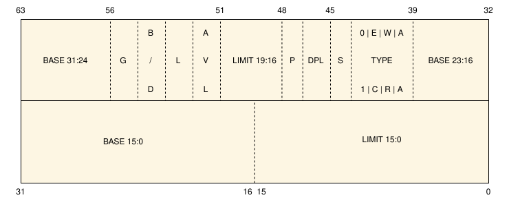

# Global Descriptor Table

## Memory segmentation in protected mode

In protected mode, memory segmentation is completely redesigned. Fixed 64 KB real mode segments are gone. Instead, each segment is now defined by a special data structure called a `Segment Descriptor` which specifies the properties of a memory segment. The segment descriptors are stored in a special structure called the `Global Descriptor Table` or `GDT`. Whenever a segment register is loaded, the CPU consults this table. The GDT itself is just a block of memory. Its address is stored in the special CPU register called `gdtr`.  This is a 48-bit register and consists of two parts:

- The size of the Global Descriptor Table
- The address of the Global Descriptor Table

Later, we will see exactly how the Linux kernel builds and loads its GDT. For now, it's enough to know that the CPU provides a dedicated instruction to load the table's address into the GDTR register:

```assembly
lgdt gdt
```

As mentioned above, the GDT contains `segment descriptors` which describe memory segments. Now let's see what segment descriptors look like. Each descriptor is 64 bits in size. The general scheme of a descriptor is:



Do not worry! I know it may look a little bit intimidating at first glance, especially in comparison to the relatively simple addressing in real mode, but we will go through it in detail. We will start from the bottom, from right to left.

The first field is `LIMIT 15:0`. It represents the first 16 bits of the segment limit. The second part is located at the bits `51:48`. This field provides information about the size of a segment. With a 20-bit limit field, it may seem that the max size of a memory segment is 1 MB, but this is not the case. The max size of a segment also depends on the 55th `G` bit:

- If `G=0` - the value of the `LIMIT` field is interpreted in bytes.
- If `G=1` - the value of the `LIMIT` field is interpreted in 4 KB units called pages.

Based on this, we can easily calculate that the max size of a segment is 4 GB.

The next field is `BASE`. We can see that it is split into three parts. The first part occupies bits from `16` to `31`, the second part occupies bits from `32` to `39`, and the last third part occupies bits from `56` to `63`. The main goal of this field is to store the base address of a segment.

The remaining fields in a segment descriptor represent flags that control different aspects of a segment, such as the type of memory. Let's take a look at the description of these flags:

- `Type` - describes the type of a memory segment.
- `S` - distinguishes system segments from code and data segments.
- `DPL` - provides information about the privilege level of a segment. It can be a value from `0` to `3`, where `0` is the level with the highest privileges.
- `P` - tells the CPU whether a segment is present in memory.
- `AVL` - available and reserved bits. It is ignored by the Linux kernel.
- `L` - indicates whether a code segment contains 64-bit code.
- `D / B` - has a different meaning depending on the type of a segment.
  - For a code segment: Controls the default operand and address size. If the bit is clear, it is a 16-bit code segment. Otherwise it is a 32-bit code segment.
  - For a stack segment or in other words a data segment pointed to by the `ss` register: Controls the default stack pointer size. If the bit is clear, it is a 16-bit stack segment and stack operations use `sp` register. Otherwise it is a 32-bit stack segment and stack operations use `esp` register.
  - For an expand-down data segment: Specifies the upper bound of the segment. If the bit is clear, the upper bound is `0xFFFF` or 64 KB. Otherwise, it is `0xFFFFFFFF` or 4 GB.

If the `S` flag of a segment descriptor is set, the descriptor describes either a code or a data segment, otherwise it is a system segment. If the highest order bit of the `Type` flags is clear - this descriptor describes a data segment, otherwise a code segment. The remaining three bits of a data segment descriptor are interpreted as:

- `Accessed` - indicates whether a segment has been accessed since the last time the kernel cleared this bit.
- `Write-Enable` - determines whether a segment is writable or read-only.
- `Expansion-Direction` - determines whether addresses decrease from the base address or not.

For a code segment, these three bits are interpreted as:

- `Accessed` - indicates whether a segment has been accessed since the last time the kernel cleared this bit.
- `Read-Enable` - determines whether a segment is execute-only or execute-read.
- `Conforming` - determines how privilege level changes are handled when transferring execution to that segment.

In the tables below you can find full information about possible states of the flags for code and data segments.

A data segment `Type` field:

| E (Expand-Down) | W (Writable) | A (Accessed) | Description                       |
| --------------- | ------------ | ------------ | --------------------------------- |
| 0               | 0            | 0            | Read-Only                         |
| 0               | 0            | 1            | Read-Only, accessed               |
| 0               | 1            | 0            | Read/Write                        |
| 0               | 1            | 1            | Read/Write, accessed              |
| 1               | 0            | 0            | Read-Only, expand-down            |
| 1               | 0            | 1            | Read-Only, expand-down, accessed  |
| 1               | 1            | 0            | Read/Write, expand-down           |
| 1               | 1            | 1            | Read/Write, expand-down, accessed |

A code segment `Type` field:

| C (Conforming) | R (Readable) | A (Accessed) | Description                        |
| -------------- | ------------ | ------------ | ---------------------------------- |
| 0              | 0            | 0            | Execute-Only                       |
| 0              | 0            | 1            | Execute-Only, accessed             |
| 0              | 1            | 0            | Execute/Read                       |
| 0              | 1            | 1            | Execute/Read, accessed             |
| 1              | 0            | 0            | Execute-Only, conforming           |
| 1              | 1            | 0            | Execute/Read, conforming           |
| 1              | 0            | 1            | Execute-Only, conforming, accessed |
| 1              | 1            | 1            | Execute/Read, conforming, accessed |

So far, we've looked at how a segment descriptor defines the properties of a memory segment - its base, limit, type, and different flags. But how does the CPU actually refer to one of these descriptors during execution? Just like in real mode - using segment registers. In protected mode they contain segment selectors. However, in protected mode, a segment selector is handled differently. Each segment descriptor has an associated segment selector which is a 16-bit structure:


The meaning of the fields is:

- `Index` - the entry number of the descriptor in the descriptor table.
- `TI` - indicates where to search for the descriptor
  - If the value of the bit is `0`, a descriptor will be searched in the Global Descriptor Table.
  - If the value of this bit is `1`, a descriptor will be searched in the Local Descriptor Table.
- `RPL` - the privilege level requested by the selector.

When a program running in protected mode references memory, the CPU needs to calculate a proper physical address. The following steps are needed to get a physical address in protected mode:

1. A segment selector is loaded into one of the segment registers.
2. The CPU tries to find an associated segment descriptor in the Global Descriptor Table based on the `Index` value from the segment selector. If the descriptor was found, it is loaded into a special hidden part of this segment register.
3. The physical address will be the base address from the segment descriptor plus the offset from the instruction pointer or memory location referenced within an executed instruction.
